# Arquitetura de Plugins do OpenPaintR (`.rpdn-plugin`)

Este documento define o formato portátil, o modelo de execução híbrido (**WebAssembly + shaders `WGSL`**) e a interface de **UI declarativa** usados por todas as extensões do OpenPaintR.

> **Regra do projeto:** Todos os efeitos do menu **Efeitos** são implementados exclusivamente como plugins `.rpdn-plugin`, utilizando exatamente a mesma API pública e a mesma biblioteca mínima (`rustpdn-plugin-sdk`) disponibilizadas para desenvolvedores terceiros.

## 1. Objetivos e garantias multiplataforma

- **Binário único real:** um mesmo arquivo `.rpdn-plugin` roda sem recompilação em **Windows, macOS e Linux** (`x86_64` e `aarch64`), sem `.dll`, `.so` ou `.dylib`.
- **Execução híbrida (CPU + GPU):**
  - **`plugin.wasm`** (`wasm32-unknown-unknown` com `simd128`): executa no host em sandbox via **`wasmtime`**, definindo parâmetros, validando opções, planejando passes e processando tiles na CPU.
  - **`*.wgsl`** (opcional): *compute shaders* portáteis validados via **`naga`** e executados via **`wgpu`** sobre Vulkan (Linux/Windows), DirectX 12 (Windows) ou Metal (macOS).
  - **Paridade e fallback:** todo plugin pode rodar em GPU quando disponível e mantém implementação Wasm de referência para ambientes sem GPU compatível, testes automatizados no Linux/WSL e inspeção determinística.
- **UI Declarativa integrada ao host:** plugins nunca criam janelas do sistema operacional nem dependem de bibliotecas gráficas; o host monta os controles diretamente em **`egui`**, herdando automaticamente os temas **Claro Pastel** e **Escuro Elegante**, prévia assíncrona e atalhos.
- **Segurança e estabilidade:** memória linear isolada por instância, ausência de acesso arbitrário a disco/rede, limite de memória e interrupção cooperativa (epoch/fuel) ao cancelar uma prévia obsoleta. Erros no plugin exibem diagnóstico na barra/diálogo sem fechar o editor.
- **Fidelidade à seleção e antialiasing:** plugins operam apenas sobre tiles copiados da camada ativa; a gravação final no documento é sempre feita pelo host ponderada pela máscara `TMask` com **SSAA (4×4)** ativo 100% do tempo.

## 2. Fluxo arquitetural

```mermaid
flowchart LR
    PKG["Pacote .rpdn-plugin (manifest.json + plugin.wasm + .wgsl)"] --> LOADER["PluginLoader (Validacao + Cache)"]
    LOADER --> UIHOST["PluginUiHost (egui Tema Pastel/Escuro)"]
    UIHOST -->|"ParamBag"| SESSION["EffectSession (Debounce + Cancelamento)"]
    SESSION -->|"plan_render"| PLAN{"Modo de Execucao"}
    PLAN -->|"CpuTiles"| WASM["Wasmtime Sandbox (SIMD128)"]
    PLAN -->|"GpuPasses"| WGPU["Pipeline wgpu (WGSL via naga)"]
    WGPU -.->|"Fallback sem GPU"| WASM
    WASM --> COMP["Compositor Host TMask (SSAA 4x4)"]
    WGPU --> COMP
    COMP -->|"Edit::Raster unico"| HIST["Historico e Repetir Ultimo Efeito"]
```



## 3. Estrutura do pacote `.rpdn-plugin`

O arquivo `.rpdn-plugin` é um arquivo **ZIP** padrão (sem compressão proprietária) contendo:

```text
meu-efeito.rpdn-plugin
├── manifest.json          # Metadados, capacidades e pontos de entrada
├── plugin.wasm            # Módulo WebAssembly obrigatório
├── shaders/               # Opcional: compute shaders WGSL
│   ├── pass_h.wgsl
│   └── pass_v.wgsl
└── assets/                # Opcional: ícone vetorial SVG/JSON e traduções
    └── icon.svg
```

### 3.1. Esquema de `manifest.json` (versão 1)

```json
{
  "schema_version": 1,
  "id": "org.rustpdn.effects.gaussian-blur",
  "name": "Desfoque Gaussiano",
  "version": "1.0.0",
  "api_version": "1.0",
  "kind": "effect",
  "author": "Equipe OpenPaintR",
  "license": "MIT",
  "menu": {
    "category": "Desfoques",
    "label": "Desfoque Gaussiano...",
    "order": 30,
    "shortcut_action": "effects.gaussian_blur"
  },
  "capabilities": {
    "cpu_wasm": true,
    "gpu_wgsl": true,
    "pixel_format": "rgba32float",
    "max_halo_px": 256,
    "needs_seed": false,
    "supports_repeat": true
  },
  "entrypoints": {
    "wasm": "plugin.wasm",
    "shaders": [
      { "id": "blur_h", "path": "shaders/pass_h.wgsl", "entry": "cs_main" },
      { "id": "blur_v", "path": "shaders/pass_v.wgsl", "entry": "cs_main" }
    ]
  }
}
```

| Campo | Tipo | Obrigatório | Descrição |
| --- | --- | :---: | --- |
| `schema_version` | `u32` | Sim | Versão do formato do manifesto (`1`). |
| `id` | `string` | Sim | Identificador reverso único (`[a-z0-9._-]+`). |
| `name` / `version` | `string` | Sim | Nome exibido no catálogo e versão SemVer do plugin. |
| `api_version` | `string` | Sim | Versão da ABI de plugins esperada (`"1.0"`). |
| `kind` | `string` | Sim | `"effect"` na Fase 4; `"adjustment"` e `"filetype"` reservados para Fase 5. |
| `menu.category` | `string` | Sim | Submenu em **Efeitos** (ex.: `"Desfoques"`, `"Artístico"`, `"Ruído"`). |
| `menu.shortcut_action` | `string` | Não | Identificador estável registrado em `atalhos.schema.json` quando houver atalho padrão. |
| `capabilities.pixel_format` | `string` | Sim | `"rgba8unorm"` ou `"rgba32float"` (linear pré-multiplicado ou não-pré-multiplicado explícito). |
| `capabilities.max_halo_px` | `u32` | Sim | Raio máximo de vizinhança exigido em pixels ao redor de cada tile. |
| `entrypoints.wasm` | `string` | Sim | Caminho relativo ao `.wasm` dentro do ZIP. |
| `entrypoints.shaders` | `array` | Não | Shaders `WGSL` declarados com `id`, `path` e nome do ponto de entrada `entry`. |

### 3.2. Descoberta e precedência

O `PluginLoader` varre na inicialização (e ao recarregar plugins):
1. **Embutidos (oficiais):** pacotes `.rpdn-plugin` enviados junto à distribuição do OpenPaintR (menu padrão **Efeitos**).
2. **Diretório do sistema:** pasta compartilhada de instalação do aplicativo.
3. **Diretório do usuário:**
   - **Linux:** `$XDG_DATA_HOME/openpaintr/plugins` (padrão `~/.local/share/openpaintr/plugins`)
   - **Windows:** `%APPDATA%\OpenPaintR\plugins`
   - **macOS:** `~/Library/Application Support/OpenPaintR/plugins`

Em caso de `id` duplicado, pacotes com versão SemVer mais recente no diretório do usuário podem sobrepor pacotes antigos somente com consentimento explícito; plugins embutidos oficiais preservam verificação de integridade.

## 4. Contrato ABI / WIT (`rustpdn:plugin@1.0.0`)

A fronteira entre o host OpenPaintR e `plugin.wasm` usa tipos puramente valoráveis e buffers lineares (compatível com **WIT / Component Model** e representação binária estável):

```wit
package rustpdn:plugin@1.0.0;

interface types {
    enum pixel-format {
        rgba8-unorm,
        rgba32-float,
    }

    enum border-mode {
        clamp,
        mirror,
        wrap,
        transparent,
    }

    record effect-context {
        doc-width: u32,
        doc-height: u32,
        dpi-x: f32,
        dpi-y: f32,
        primary-rgba: list<u8>,
        secondary-rgba: list<u8>,
        has-selection: bool,
        sel-bounds: option<tuple<u32, u32, u32, u32>>,
        seed: u64,
    }

    record tile-region {
        out-x: u32,
        out-y: u32,
        out-w: u32,
        out-h: u32,
        in-x: s32,
        in-y: s32,
        in-w: u32,
        in-h: u32,
        halo: u32,
    }

    variant param-value {
        float32(f32),
        int32(s32),
        boolean(bool),
        rgba8(list<u8>),
        vec2(tuple<f32, f32>),
        choice(u32),
        seed(u64),
    }

    record param-entry {
        key: string,
        val: param-value,
    }

    record gpu-pass-desc {
        shader-id: string,
        workgroup-size: tuple<u32, u32, u32>,
        uniform-bytes: list<u8>,
        reads-previous-pass: bool,
    }

    variant render-plan {
        cpu-tiles(tuple<u32, border-mode, pixel-format>),
        gpu-passes(tuple<u32, border-mode, pixel-format, list<gpu-pass-desc>>),
    }
}

world effect-plugin {
    use types.{effect-context, param-entry, render-plan, tile-region};

    export describe-ui: func() -> list<u8>; // UiSchema serializado
    export validate-params: func(ctx: effect-context, params: list<param-entry>) -> result<list<param-entry>, string>;
    export plan-render: func(ctx: effect-context, params: list<param-entry>) -> result<render-plan, string>;
    export render-tile: func(
        ctx: effect-context,
        params: list<param-entry>,
        region: tile-region,
        src-pixels: list<u8>,
    ) -> result<list<u8>, string>;
}
```

## 5. Modelo de execução híbrida (CPU Wasm + GPU WGSL)

### 5.1. Pipeline por tiles em CPU (`CpuTiles`)

1. Antes do processamento, o host consulta `plan_render(ctx, params)`, que retorna `(halo_px, border_mode, pixel_format)`.
2. O host particiona o *bounding box* da seleção ativa (ou o documento inteiro, caso não haja seleção) em **tiles de `256 × 256 px`**.
3. Durante a **prévia interativa**, os tiles visíveis na área atual da tela são agendados com prioridade máxima; se o usuário mover um slider, o token de cancelamento sinaliza ao *epoch* do `wasmtime` para interromper o lote antigo imediatamente.
4. Para cada tile, o host preenche o buffer expandido `(256 + 2 * halo_px) × (256 + 2 * halo_px)` aplicando o `border_mode` escolhido nas bordas do documento e chama `render_tile` em um pool de threads do host (uma `Store`/instância Wasm por worker thread).

### 5.2. Pipeline GPU com shaders `WGSL` (`GpuPasses`)

Para efeitos paralelos de alto custo (desfoques de raio grande, distorções, fractais, brilho difuso):
1. `plan_render` retorna `RenderPlan::GpuPasses(halo_px, border_mode, pixel_format, passes)`.
2. Cada passe informa:
   - `shader_id`: identificador listado em `manifest.json`;
   - `uniform_bytes`: struct `#[repr(C)]` alinhada em 16 bytes (`std140` / `bytemuck::Pod`);
   - `reads_previous_pass`: permite encadear múltiplos passes *ping-pong* (ex.: passe horizontal + passe vertical).
3. **Layout fixo de bindings WGSL do OpenPaintR (Grupo 0):**

| Binding | Tipo WGSL | Uso |
| --- | --- | --- |
| `@group(0) @binding(0)` | `texture_2d<f32>` | Textura de entrada (camada ou saída do passe anterior). |
| `@group(0) @binding(1)` | `texture_storage_2d<rgba32float, write>` | Textura de saída do passe atual. |
| `@group(0) @binding(2)` | `sampler` | Sampler linear/clamp gerenciado pelo host conforme `border_mode`. |
| `@group(0) @binding(3)` | `var<uniform> host: HostUniforms` | Dimensões (`width`, `height`), `seed`, cores primária/secundária e DPI. |
| `@group(0) @binding(4)` | `var<uniform> params: PluginUniforms` | `uniform_bytes` fornecidos pelo módulo Wasm do plugin. |

4. Se o ambiente não possuir dispositivo `wgpu` suportado (ex.: sessão headless ou GPU incompatível), o host redireciona automaticamente a execução para `render_tile` no módulo Wasm.

### 5.3. Composição final e seleção `TMask` (SSAA 4×4)

O plugin **nunca escreve diretamente no `Document`**. Ao receber o buffer processado de cada tile:
- Se não houver seleção ativa, o host grava o tile diretamente na camada temporária de prévia/commit.
- Se houver seleção ativa, o host intercala cada pixel `(x, y)` entre `original` e `efeito` pela cobertura `cov = selection.coverage_u8((x, y))` da máscara `TMask` (**SSAA 4×4**).
- Na confirmação (`OK`), o host gera apenas um registro `Edit::Raster` no histórico do documento com as alterações consolidadas.

## 6. Interface de UI Declarativa (`UiSchema`) e Montagem no OpenPaintR

### 6.1. Modelo de dados declarativo (`UiSchema`)

O plugin descreve sua tela usando apenas estruturas declarativas (sem callbacks de UI nem tipos de janela):

```rust
pub struct UiSchema {
    pub title: String,
    pub width_hint: Option<f32>,
    pub live_preview_default: bool,
    pub nodes: Vec<UiNode>,
}

pub enum UiNode {
    Section {
        title: String,
        collapsible: bool,
        default_open: bool,
        children: Vec<UiNode>,
    },
    Row(Vec<UiNode>),
    Separator,
    InfoText {
        text: String,
        muted: bool,
    },
    Control(ControlSpec),
}

pub struct ControlSpec {
    pub key: String,
    pub label: String,
    pub help: Option<String>,
    pub visible_if: Option<VisibilityRule>,
    pub enabled_if: Option<VisibilityRule>,
    pub kind: ControlKind,
}

pub enum ControlKind {
    SliderF32 { min: f32, max: f32, default: f32, step: Option<f32>, unit: Option<String>, logarithmic: bool },
    SliderI32 { min: i32, max: i32, default: i32, unit: Option<String> },
    Angle { default_deg: f32 },
    CenterOffset { default_x: f32, default_y: f32 },
    Color { default_rgba: [u8; 4], allow_alpha: bool },
    Checkbox { default: bool },
    Select { default: u32, options: Vec<EnumOption> },
    Radio { default: u32, options: Vec<EnumOption> },
    Seed { default: u64 },
}

pub struct VisibilityRule {
    pub key: String,
    pub equals: ParamValue,
}
```

### 6.2. Interface de montagem no OpenPaintR (`PluginUiHost`)

Dentro do editor (`src/gui/`), a montagem da UI declarativa é centralizada no módulo host `PluginUiHost` / `EffectDialogController`:

```rust
pub struct EffectModalState {
    pub plugin_id: PluginId,
    pub schema: UiSchema,
    pub params: ParamBag,
    pub preview_enabled: bool,
    pub running_job: Option<PreviewJobHandle>,
    pub last_error: Option<String>,
}

pub trait PluginUiHost {
    /// Renderiza o `UiSchema` como cartão/modal em `egui` usando `Theme::styled_card`,
    /// retornando `true` sempre que algum parâmetro for alterado pelo usuário.
    fn show_schema(
        &self,
        ui: &mut egui::Ui,
        theme: Theme,
        schema: &UiSchema,
        params: &mut ParamBag,
    ) -> bool;

    /// Renderiza a janela flutuante completa do efeito: título, controles gerados,
    /// checkbox "Prévia", indicador de progresso, "Restaurar padrões", "Cancelar" e "OK".
    fn show_effect_modal(
        &self,
        ctx: &egui::Context,
        theme: Theme,
        state: &mut EffectModalState,
    ) -> ModalOutcome;
}
```

Comportamento padronizado pelo host para todo plugin:
- **Identidade visual automática:** todos os grupos `Section` usam o mesmo estilo visual de `Theme::styled_card`, e sliders, checkboxes, seletores de ângulo (mostrador circular) e cores herdando o tema ativo (**Moderno Pastel** ou **Escuro Elegante**).
- **Restaurar padrões:** botão automático no rodapé redefine `params` com todos os valores `default` do `UiSchema` e re-dispara a prévia.
- **Prévia ao vivo e cancelamento:** alterar qualquer controle chama `validate_params` e agenda novo processamento com curto *debounce* (ex.: 16–32 ms), cancelando imediatamente o trabalho anterior.
- **Repetição do último efeito:** ao clicar em **OK**, o host armazena `(plugin_id, params)` no estado da sessão para o atalho **Repetir último efeito** (`Ctrl+F` no perfil Paint.NET), reaplicando o efeito sem abrir o diálogo novamente.

## 7. Biblioteca mínima de plugins (`rustpdn-plugin-sdk`)

Para que nenhum autor precise lidar manualmente com serialização ABI ou ponteiros crus Wasm, o workspace fornecerá a crate `#![no_std]` (com `alloc`) **`crates/rustpdn-plugin-sdk`**:

| Módulo | Responsabilidade |
| --- | --- |
| `sdk::meta` | Contexto do documento (`EffectContext`), leitura de cores primária/secundária e semente. |
| `sdk::ui` | `UiBuilder` fluente para declarar `SliderF32`, `SliderI32`, `Angle`, `CenterOffset`, `Color`, `Select`, `Seed` e regras `visible_if`. |
| `sdk::params` | `Params` para leitura tipada por chave (`f32_or`, `i32_or`, `bool_or`, `color_or`, `seed_or`, `choice_or`). |
| `sdk::tile` | `TileView` (leitura segura `(x, y)` com halo pré-expandido e helpers RGBA8/RGBA32F), `TileMut` e utilitários de pré-multiplicação alfa. |
| `sdk::gpu` | `GpuPlanBuilder` para montar `RenderPlan::GpuPasses` com serialização segura via `bytemuck`. |
| `sdk::simd` | Wrappers leves sobre `core::arch::wasm32` (`v128`) para vetores de 4 floats RGBA. |
| `sdk::export_effect!` | Macro que registra o trait `EffectPlugin` e gera automaticamente os exports exigidos pelo runtime Wasm. |
