# OpenPaintR Plugin Architecture (`.rpdn-plugin`)

This document specifies the planned portable package format, hybrid execution model (**WebAssembly and WGSL shaders**), and declarative UI for OpenPaintR extensions.

> **Project rule** — Implement every effect in the **Effects** menu as a `.rpdn-plugin`, using the public API and minimal `rustpdn-plugin-sdk` available to third-party developers.

## 1. Cross-platform goals and guarantees

- **One package.** The same `.rpdn-plugin` file runs on **Windows, macOS, and Linux** (`x86_64` and `aarch64`) without recompilation or platform-specific `.dll`, `.so`, or `.dylib` files.
- **Hybrid CPU and GPU execution.**
  - **`plugin.wasm`** (`wasm32-unknown-unknown` with `simd128`) runs in a **`wasmtime`** sandbox. It defines parameters, validates options, plans passes, and processes tiles on the CPU.
  - Optional **`*.wgsl`** compute shaders are validated by **`naga`** and run through **`wgpu`** on Vulkan (Linux and Windows), DirectX 12 (Windows), or Metal (macOS).
  - **Parity and fallback.** Plugins with a GPU path can use it when available. The reference Wasm implementation supports systems without a compatible GPU, automated Linux and WSL tests, and deterministic inspection.
- **Host-rendered declarative UI.** The host creates controls directly in **`egui`** and provides the active light pastel or dark theme, asynchronous previews, and shortcuts. Plugins use the host UI and require no GUI libraries or native windows.
- **Security and stability.** Isolate linear memory per instance, deny arbitrary disk and network access, limit memory, and use cooperative epoch or fuel interruption to cancel obsolete previews. Report plugin errors in the status bar or dialog while keeping the editor open.
- **Selection fidelity and antialiasing.** Plugins work on tiles copied from the active layer. The host commits the results using the selection's own `TMask` coverage, as rasterized under the antialiasing mode active when the selection was created.

## 2. Architecture flow

```mermaid
flowchart LR
    PKG[".rpdn-plugin package (manifest.json + plugin.wasm + .wgsl)"] --> LOADER["PluginLoader (validation and cache)"]
    LOADER --> UIHOST["PluginUiHost (egui light or dark theme)"]
    UIHOST -->|"ParamBag"| SESSION["EffectSession (debounce and cancellation)"]
    SESSION -->|"plan_render"| PLAN{"Execution mode"}
    PLAN -->|"CpuTiles"| WASM["Wasmtime sandbox (SIMD128)"]
    PLAN -->|"GpuPasses"| WGPU["wgpu pipeline (WGSL via naga)"]
    WGPU -.->|"CPU fallback"| WASM
    WASM --> COMP["Host TMask compositor (selection coverage)"]
    WGPU --> COMP
    COMP -->|"One Edit::Raster entry"| HIST["History and Repeat Last Effect"]
```



## 3. Package layout

A `.rpdn-plugin` is a standard **ZIP** archive with the following layout.

```text
my-effect.rpdn-plugin
├── manifest.json          # Metadata, capabilities, and entry points
├── plugin.wasm            # Required WebAssembly module
├── shaders/               # Optional WGSL compute shaders
│   ├── pass_h.wgsl
│   └── pass_v.wgsl
└── assets/                # Optional SVG/JSON vector icon and translations
    └── icon.svg
```

### 3.1. Version 1 `manifest.json` schema

```json
{
  "schema_version": 1,
  "id": "org.rustpdn.effects.gaussian-blur",
  "name": "Gaussian Blur",
  "version": "1.0.0",
  "api_version": "1.0",
  "kind": "effect",
  "author": "OpenPaintR Team",
  "license": "MIT",
  "menu": {
    "category": "Blurs",
    "label": "Gaussian Blur...",
    "order": 30,
    "shortcut_action": "effects.gaussian_blur"
  },
  "capabilities": {
    "cpu_wasm": true,
    "gpu_wgsl": true,
    "pixel_format": "rgba32float",
    "max_halo_px": 256,
    "needs_seed": false,
    "supports_repeat": true
  },
  "entrypoints": {
    "wasm": "plugin.wasm",
    "shaders": [
      { "id": "blur_h", "path": "shaders/pass_h.wgsl", "entry": "cs_main" },
      { "id": "blur_v", "path": "shaders/pass_v.wgsl", "entry": "cs_main" }
    ]
  }
}
```

| Field | Type | Required | Description |
| --- | --- | :---: | --- |
| `schema_version` | `u32` | Yes | Manifest format version (`1`). |
| `id` | `string` | Yes | Unique reverse-domain identifier (`[a-z0-9._-]+`). |
| `name` / `version` | `string` | Yes | Catalog display name and plugin SemVer version. |
| `api_version` | `string` | Yes | Expected plugin ABI version (`"1.0"`). |
| `kind` | `string` | Yes | Use `"effect"` in phase 4. The values `"adjustment"` and `"filetype"` are reserved for phase 5. |
| `menu.category` | `string` | Yes | Submenu under **Effects**, such as `"Blurs"`, `"Artistic"`, or `"Noise"`. |
| `menu.shortcut_action` | `string` | No | Stable identifier registered in `shortcuts.schema.json` when the effect has a default shortcut. |
| `capabilities.pixel_format` | `string` | Yes | `"rgba8unorm"` or `"rgba32float"`, with explicit premultiplied or straight linear alpha. |
| `capabilities.max_halo_px` | `u32` | Yes | Maximum neighborhood radius in pixels around each tile. |
| `entrypoints.wasm` | `string` | Yes | Relative path to the `.wasm` file inside the ZIP archive. |
| `entrypoints.shaders` | `array` | No | WGSL shaders with `id`, `path`, and an `entry` point name. |

### 3.2. Discovery and precedence

At startup and on reload, `PluginLoader` searches these locations in order.
1. **Built-in packages.** Official `.rpdn-plugin` packages shipped with OpenPaintR make up the default **Effects** menu.
2. **System directory.** The shared application installation.
3. **User directory.**
   - **Linux** — `$XDG_DATA_HOME/openpaintr/plugins` (defaults to `~/.local/share/openpaintr/plugins`)
   - **Windows** — `%APPDATA%\OpenPaintR\plugins`
   - **macOS** — `~/Library/Application Support/OpenPaintR/plugins`

When IDs collide, a newer SemVer package in the user directory can override an older package only with explicit consent. Official built-in plugins retain integrity verification.

## 4. ABI and WIT contract (`rustpdn:plugin@1.0.0`)

The boundary between the host and `plugin.wasm` uses value types and linear buffers for WIT and Component Model compatibility and a stable binary representation.

```wit
package rustpdn:plugin@1.0.0;

interface types {
    enum pixel-format {
        rgba8-unorm,
        rgba32-float,
    }

    enum border-mode {
        clamp,
        mirror,
        wrap,
        transparent,
    }

    record effect-context {
        doc-width: u32,
        doc-height: u32,
        dpi-x: f32,
        dpi-y: f32,
        primary-rgba: list<u8>,
        secondary-rgba: list<u8>,
        has-selection: bool,
        sel-bounds: option<tuple<u32, u32, u32, u32>>,
        seed: u64,
    }

    record tile-region {
        out-x: u32,
        out-y: u32,
        out-w: u32,
        out-h: u32,
        in-x: s32,
        in-y: s32,
        in-w: u32,
        in-h: u32,
        halo: u32,
    }

    variant param-value {
        float32(f32),
        int32(s32),
        boolean(bool),
        rgba8(list<u8>),
        vec2(tuple<f32, f32>),
        choice(u32),
        seed(u64),
    }

    record param-entry {
        key: string,
        val: param-value,
    }

    record gpu-pass-desc {
        shader-id: string,
        workgroup-size: tuple<u32, u32, u32>,
        uniform-bytes: list<u8>,
        reads-previous-pass: bool,
    }

    variant render-plan {
        cpu-tiles(tuple<u32, border-mode, pixel-format>),
        gpu-passes(tuple<u32, border-mode, pixel-format, list<gpu-pass-desc>>),
    }
}

world effect-plugin {
    use types.{effect-context, param-entry, render-plan, tile-region};

    export describe-ui: func() -> list<u8>; // Serialized UiSchema
    export validate-params: func(ctx: effect-context, params: list<param-entry>) -> result<list<param-entry>, string>;
    export plan-render: func(ctx: effect-context, params: list<param-entry>) -> result<render-plan, string>;
    export render-tile: func(
        ctx: effect-context,
        params: list<param-entry>,
        region: tile-region,
        src-pixels: list<u8>,
    ) -> result<list<u8>, string>;
}
```

## 5. Hybrid execution model (CPU Wasm and GPU WGSL)

### 5.1. CPU tile pipeline (`CpuTiles`)

1. Before processing, the host calls `plan_render(ctx, params)`, which returns `(halo_px, border_mode, pixel_format)`.
2. The host divides the active selection's bounding box, or the whole document when there is no selection, into **`256 × 256 px` tiles**.
3. During an interactive preview, visible tiles receive top priority. When a slider moves, the cancellation token signals the `wasmtime` epoch to interrupt the previous batch.
4. For each tile, the host fills an expanded `(256 + 2 * halo_px) × (256 + 2 * halo_px)` buffer using the selected `border_mode` at document edges. It then calls `render_tile` in a host thread pool, with one Wasm instance and `Store` per worker.

### 5.2. GPU pipeline with WGSL shaders (`GpuPasses`)

Use this pipeline for costly parallel effects such as large-radius blurs, distortions, fractals, and glow.
1. `plan_render` returns `RenderPlan::GpuPasses(halo_px, border_mode, pixel_format, passes)`.
2. Each pass declares the following fields.
   - `shader_id` identifies the shader listed in `manifest.json`.
   - `uniform_bytes` contains a 16-byte-aligned `#[repr(C)]` struct (`std140` / `bytemuck::Pod`).
   - `reads_previous_pass` chains ping-pong passes, such as horizontal and vertical blur.
3. OpenPaintR reserves the following WGSL bindings in group 0.

| Binding | WGSL type | Purpose |
| --- | --- | --- |
| `@group(0) @binding(0)` | `texture_2d<f32>` | Input texture from the layer or previous pass. |
| `@group(0) @binding(1)` | `texture_storage_2d<rgba32float, write>` | Output texture for the current pass. |
| `@group(0) @binding(2)` | `sampler` | Host-managed linear/clamp sampler that follows `border_mode`. |
| `@group(0) @binding(3)` | `var<uniform> host: HostUniforms` | Dimensions (`width`, `height`), `seed`, primary and secondary colors, and DPI. |
| `@group(0) @binding(4)` | `var<uniform> params: PluginUniforms` | `uniform_bytes` supplied by the plugin's Wasm module. |

4. If no supported `wgpu` device is available, such as in a headless session or on incompatible hardware, the host falls back to the Wasm module's `render_tile`.

### 5.3. Final compositing and `TMask` selection coverage

The host owns writes to `Document`. When it receives a processed tile, it applies these rules.
- With no active selection, write the tile to the temporary preview or commit layer.
- With an active selection, interpolate each pixel `(x, y)` between its original and effect values using the selection's `TMask` coverage `cov = selection.coverage_u8((x, y))`.
- On **OK**, save the consolidated changes as a single `Edit::Raster` entry in the document history.

## 6. Declarative UI (`UiSchema`) and host rendering

### 6.1. Declarative data model (`UiSchema`)

The plugin describes its UI using declarative data structures without callbacks or window types.

```rust
pub struct UiSchema {
    pub title: String,
    pub width_hint: Option<f32>,
    pub live_preview_default: bool,
    pub nodes: Vec<UiNode>,
}

pub enum UiNode {
    Section {
        title: String,
        collapsible: bool,
        default_open: bool,
        children: Vec<UiNode>,
    },
    Row(Vec<UiNode>),
    Separator,
    InfoText {
        text: String,
        muted: bool,
    },
    Control(ControlSpec),
}

pub struct ControlSpec {
    pub key: String,
    pub label: String,
    pub help: Option<String>,
    pub visible_if: Option<VisibilityRule>,
    pub enabled_if: Option<VisibilityRule>,
    pub kind: ControlKind,
}

pub enum ControlKind {
    SliderF32 { min: f32, max: f32, default: f32, step: Option<f32>, unit: Option<String>, logarithmic: bool },
    SliderI32 { min: i32, max: i32, default: i32, unit: Option<String> },
    Angle { default_deg: f32 },
    CenterOffset { default_x: f32, default_y: f32 },
    Color { default_rgba: [u8; 4], allow_alpha: bool },
    Checkbox { default: bool },
    Select { default: u32, options: Vec<EnumOption> },
    Radio { default: u32, options: Vec<EnumOption> },
    Seed { default: u64 },
}

pub struct VisibilityRule {
    pub key: String,
    pub equals: ParamValue,
}
```

### 6.2. Host rendering (`PluginUiHost`)

In the editor (`src/gui/`), `PluginUiHost` and `EffectDialogController` assemble the declarative UI.

```rust
pub struct EffectModalState {
    pub plugin_id: PluginId,
    pub schema: UiSchema,
    pub params: ParamBag,
    pub preview_enabled: bool,
    pub running_job: Option<PreviewJobHandle>,
    pub last_error: Option<String>,
}

pub trait PluginUiHost {
    /// Renders the `UiSchema` as an `egui` card or modal using `Theme::styled_card`.
    /// Returns `true` when the user changes a parameter.
    fn show_schema(
        &self,
        ui: &mut egui::Ui,
        theme: Theme,
        schema: &UiSchema,
        params: &mut ParamBag,
    ) -> bool;

    /// Renders the floating effect dialog with its title, generated controls,
    /// Preview checkbox, progress indicator, Reset Defaults, Cancel, and OK.
    fn show_effect_modal(
        &self,
        ctx: &egui::Context,
        theme: Theme,
        state: &mut EffectModalState,
    ) -> ModalOutcome;
}
```

The host provides the same behavior to all plugins.
- **Theme integration.** `Section` groups use `Theme::styled_card`. Sliders, checkboxes, angle dials, and color controls inherit the active light pastel or dark theme.
- **Reset defaults.** The footer button restores every `default` from `UiSchema` to `params` and restarts the preview.
- **Live preview and cancellation.** A control change calls `validate_params`, cancels the previous job, and schedules a new render after a short debounce, such as 16–32 ms.
- **Repeat last effect.** On **OK**, the host stores `(plugin_id, params)` in the session. **Repeat Last Effect** (`Ctrl+F` in the Paint.NET profile) applies them again without opening the dialog.

## 7. Minimal plugin SDK (`rustpdn-plugin-sdk`)

The workspace will provide a `#![no_std]` crate with `alloc` at `crates/rustpdn-plugin-sdk`. It handles ABI serialization and raw Wasm pointers for plugin authors.

| Module | Responsibility |
| --- | --- |
| `sdk::meta` | Document context (`EffectContext`), primary and secondary colors, and the seed. |
| `sdk::ui` | Fluent `UiBuilder` for `SliderF32`, `SliderI32`, `Angle`, `CenterOffset`, `Color`, `Select`, `Seed`, and `visible_if` rules. |
| `sdk::params` | Typed reads by key through `Params` (`f32_or`, `i32_or`, `bool_or`, `color_or`, `seed_or`, and `choice_or`). |
| `sdk::tile` | `TileView` with safe `(x, y)` access to the expanded halo and RGBA8/RGBA32F helpers, plus `TileMut` and alpha premultiplication utilities. |
| `sdk::gpu` | `GpuPlanBuilder` for `RenderPlan::GpuPasses` with safe `bytemuck` serialization. |
| `sdk::simd` | Lightweight wrappers over `core::arch::wasm32` (`v128`) for four-channel floating-point RGBA vectors. |
| `sdk::export_effect!` | Macro that registers the `EffectPlugin` trait implementation and generates the Wasm runtime exports. |
